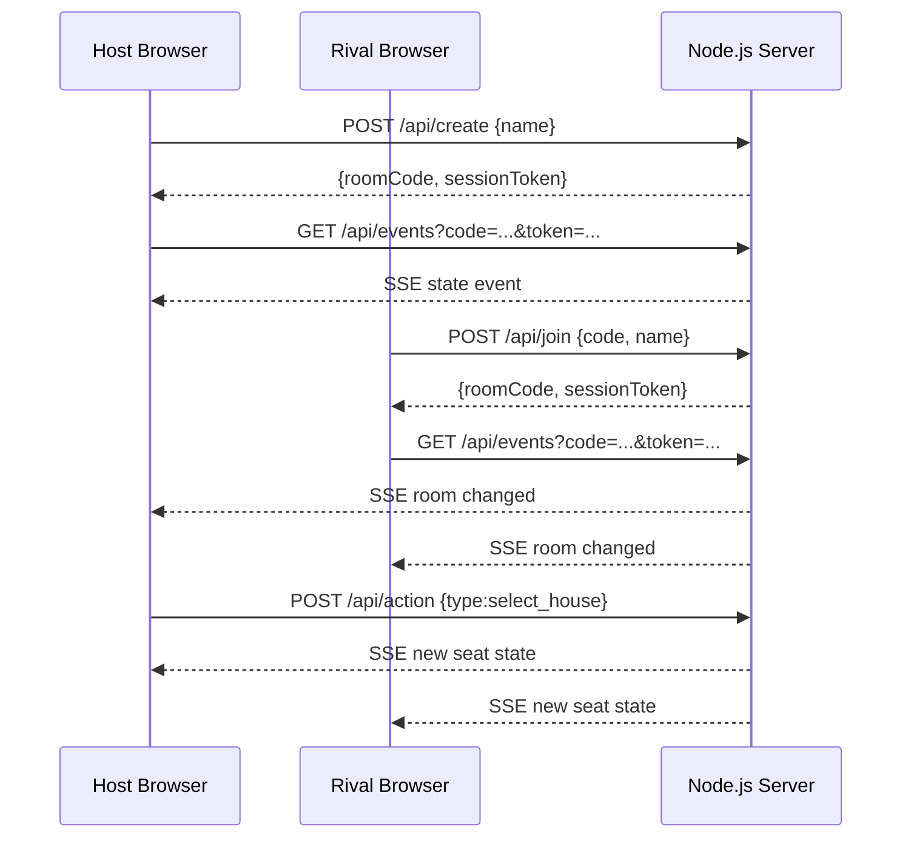
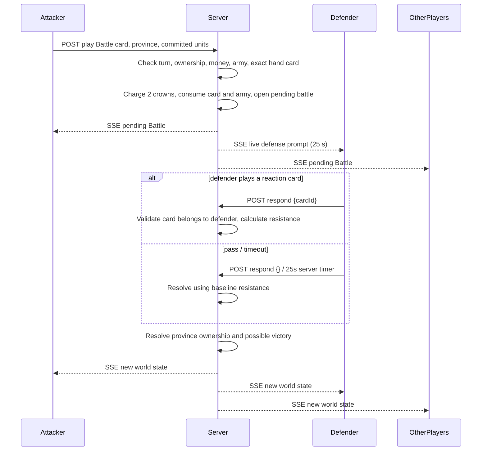

# Networking Architecture — Four Crowns

## Project objective

Build a synchronized client/server multiplayer strategy card game where **exactly four remote players share one authoritative world state**, each with a private card hand, and time-sensitive off-turn defensive reactions.

## Stack and transport

- **Node.js `http` server** handles REST-like JSON commands and serves all local assets.
- **HTTP POST** sends authenticated player actions to the server.
- **Server-Sent Events (SSE) / `EventSource`** provides persistent server-to-browser live updates.
- **Browser JavaScript** renders the interface. The browser never determines win conditions or modifies authoritative balances.
- **Adaptive local music** is provided by the browser HTMLAudioElement API, using two bundled MP3 tracks. Soundtrack scene changes derive from server-authoritative game-state updates; no audio is transmitted over SSE. Each player independently controls music volume and playback.
- **Node `crypto`** generates random room codes and unguessable session tokens.
- **In-memory `Map`** stores live room objects for this assignment. This can be replaced by Redis or a database if persistence is required.

SSE and HTTP were intentionally chosen over WebSocket for this zero-dependency prototype: the client requires bidirectional *application-level communication* (commands up, states down) but not necessarily a bidirectional frame protocol. These are established networking technologies and satisfy a real-time four-client deployment.

## Connection lifecycle



### HTTP routes

| Method | Route | Input | Output |
|---|---|---|---|
| GET | `/api/health` | none | health, active rooms |
| POST | `/api/create` | `{name}` | room code, player token/id |
| POST | `/api/join` | `{code, name}` | room code, player token/id |
| POST | `/api/resume` | `{code, token}` | private personalized state |
| POST | `/api/action` | `{code, token, type, ...arguments}` | validated result and personalized state |
| GET | `/api/events` | query `code`, `token` | live SSE `state` messages |
| GET | `/` and static paths | none | HTML/CSS/JS/WebP/MP3/MIDI assets (audio supports byte-range requests) |

### Supported action types

Lobby: `select_house`, `ready`, `start`.

Game: `play`, `end_turn`, `respond`.

Examples (demonstration only; in-game tokens are randomly generated):

```json
{
  "code": "ABC123",
  "token": "<session token>",
  "type": "play",
  "cardId": "c4z",
  "territoryId": "arunvale",
  "units": {"infantry": 4, "archers": 2, "knights": 1, "elephants": 0}
}
```

```json
{
  "code": "ABC123",
  "token": "<defender's token>",
  "type": "respond",
  "cardId": "c5a"
}
```

## Battle protocol (client/server synchronization)



**Deterministic battle formula:** `attack = sum(committed unit quantity × unit strength) + signature bonus (3 or 0) + prepared siege bonus`. `defense = province.garrison + province.fort + defense reaction bonus`. Attack succeeds only when strictly greater; Royal Shield cancels it. No random die roll is used, so the session is auditable and a demo can explain every outcome.

## Multiplayer state model

A room owns:

- `code`, `phase` (`lobby`, `playing`, `finished`), `hostId`.
- Exactly four `players` after setup, each with unique `house` and private `hand`, public `bank`, `resources`, `army`, `ready` and `connected`.
- An array of twelve `territories`, each with `owner`, `garrison` and `fort`.
- Shared randomized `deck`, `discard`, `turnIndex`, `turnNumber`, `actionsLeft`.
- Optional `pending` challenge and 25-second server-side expiration timer.
- Server `log`, victory `winnerId`, and one SSE connection per player.

### Privacy

The `serialize(room,viewer)` function produces **per-player** messages. Other players' complete hands and tokens never appear in another player's state snapshot; they see only `handCount`. Deck order is not transmitted. House information, armies, treasury, resources and province ownership are public to enable diplomacy and strategy.

### Authority and validation

Every `POST /api/action` re-authenticates the room code and token. The game engine rejects:

- A fifth player or duplicate house selection.
- Non-host attempts to start, not-ready starts, moves outside your turn.
- Cards not in the sender's private hand.
- Army deployment beyond available troop quantities; negative or fractional quantities.
- Inadequate coins, resources, or incorrect province ownership.
- Defensive reactions from anyone other than the challenged player.
- Other moves while a trade or attack response is unresolved.
- A premature victory when any province still belongs to another player.

### Reconnects and presence

The browser keeps the private session token in `sessionStorage` for page refreshes. The native `EventSource` API reconnects when a stream is interrupted. New streams replace obsolete connections for the same seat. The room's public connected status is updated whenever a player's SSE stream joins or closes.

Rooms expire after eight hours without log activity. Since this is in-memory storage, server restarts erase active matches. This is a prototype limitation, not a network protocol feature.

## Network testing matrix

| Test | Expected |
|---|---|
| 4 clients join | All see four seats and names in live lobby |
| 5th client joins | Server rejects with “already four players” |
| Two clients choose same house | Second selection rejected |
| Host starts without four ready | Server refuses to start |
| Four clients enter valid game | Everyone sees same twelve owners, turn and deck count |
| Non-active client tries to play | Server rejects move |
| Active client plays coin or resources | All four see new shared amounts |
| Active client attacks rival province | Rival instantly sees pending defense prompt |
| Rival plays Royal Shield | All clients see attack cancelled and cost consumed |
| Rival declines or misses 25-second window | Server resolves the deterministic battle |
| House sends a resource trade proposal | Recipient gets accept/decline prompt; others wait |
| Browser refresh | Its session reconnects and rehydrates private hand |
| Client copies its own token to another player | Invalid token cannot access different private hand |
| One player captures all twelve provinces | All players see identical terminal winner |

**Automated test command:** `npm test` runs engine tests, HTTP contract tests, and an actual two-client SSE propagation test with the Node test runner.

## Extension ideas for an advanced networking submission

1. **Persistent database / Redis** for match restore, matchmaking rooms and post-match statistics.
2. **HTTPS with trusted identities** for protection of room tokens in transit.
3. **Heartbeat / inactive-turn timer** that automatically advances disconnected players.
4. **Replayable server event log** and version numbers for missed-event recovery.
5. **Latency, packet-loss and reconnection benchmarking** across separate devices.
6. **Bot players, spectator view, emotes, chat and seasonal rankings.**
7. **Horizontal scaling** with Redis pub/sub or a message broker so several Node workers can share rooms.

## Academic demonstration outline

- Show four browser clients selecting different houses.
- Start the match; point out the same room code, round and map on all screens.
- Play coin and army cards in different turns; explain validation of three actions.
- Attack a province from another client. Demonstrate how the defender receives an instant prompt via SSE and the initiator must wait for the decision.
- Demonstrate resource trade and server-side balance conservation.
- Run automated tests and show successful victory detection.
- Explain one limitation: restart wipes rooms because the backend currently uses an in-memory map.

## Client-side soundtrack lifecycle

Each browser constructs two local looping `HTMLAudioElement`s after loading `soundtrack.js`:

1. The player presses **PLAY MUSIC** (a required browser gesture). The main *Oath of Serendir* track plays without changing the game engine or other players' audio settings.
2. SSE state updates cause `render()` to call `FourCrownsMusic.setScene(...)`. A pending battle changes the local soundtrack to *War Drums*; once the defender responds or times out, it transitions back to the realm theme.
3. Volume and enabled state persist in the local browser via `localStorage`. The player can mute at any moment. Browser tabs suspended in the background pause playback.
4. MP3s are served with `Content-Type: audio/mpeg`, `Accept-Ranges: bytes`, and optional HTTP 206 range responses. All files are local to this project, so the score works on the same local Wi-Fi as the game.

The soundtrack is **entirely presentation-layer state**. It does not participate in battle calculations, turn authorization, networking messages, or winner selection. Consequently network synchronization and individual sound settings remain independent.
