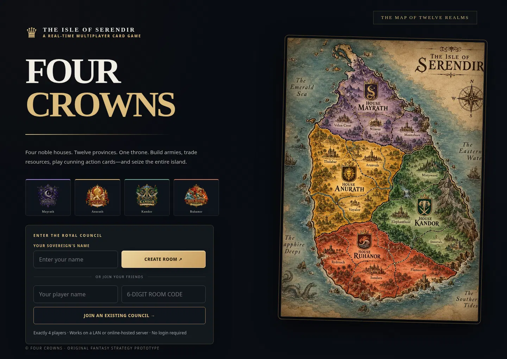
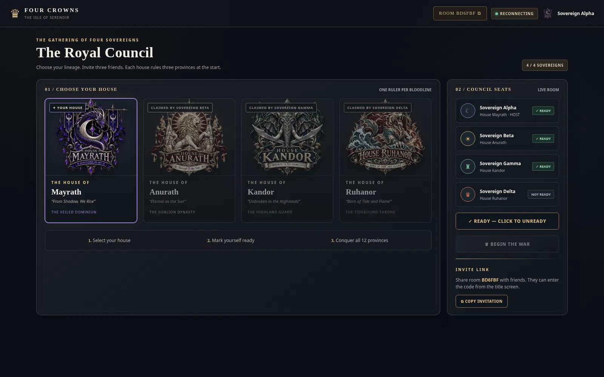
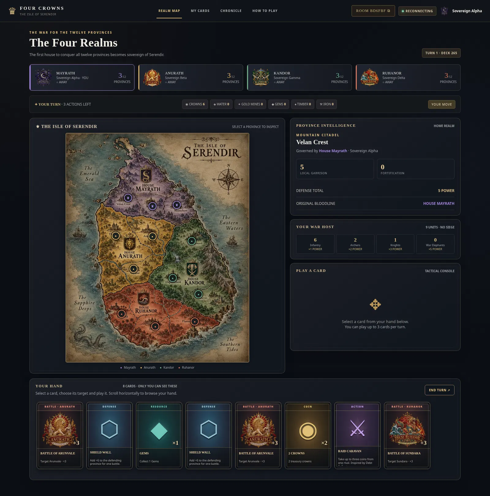
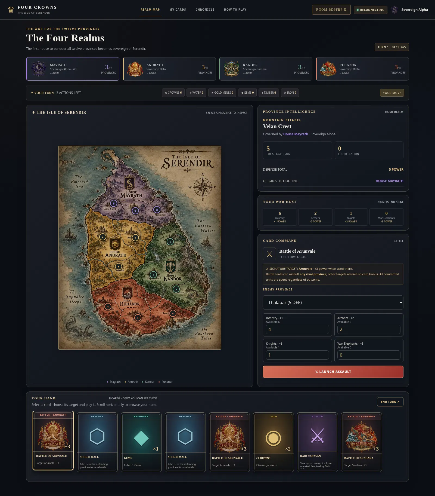

# FOUR CROWNS — The Isle of Serendir
### A real-time, four-player fantasy card conquest game

A playable networking project built with Node.js, native HTTP, Server-Sent Events, HTML, CSS and JavaScript. **The online edition is intentionally silent** and supports phones, tablets, and laptops using the same website URL. No third-party JavaScript packages or API keys are needed.

The game combines a fast-turn card system inspired by property-collecting card games with original medieval fantasy conquest mechanics. Four players choose different royal houses, trade resources, recruit units, counter attacks in real time, and fight over twelve provinces on a Sri Lanka-inspired island map. **The first player to own all twelve provinces wins.**

> The game is a unique educational prototype, not a replica of Monopoly Deal or Game of Thrones. The names, world, rules, artwork and UI are original fantasy adaptations.

## Play online on any device — deployment-ready

This version works on **Android phones, iPhones, tablets, Chromebooks, and laptops** in a browser. Once a single server is deployed, players on Wi-Fi and cellular networks all open **the same HTTPS link** and enter the six-character room code. No app-store installation is needed.

For a complete GitHub + Render walk-through, see **[ONLINE_DEPLOYMENT.md](ONLINE_DEPLOYMENT.md)**. Also included: `render.yaml`, `railway.json`, a health-check endpoint, phone-size layout improvements, and a home-screen manifest.

**Important:** The ZIP contains server-ready source code, **not** an already-hosted public site. Hosting needs an account. The game uses in-memory rooms, so an instance restart loses matches; keep a single instance.

## UI previews

| Title & room creation | House selection lobby |
|---|---|
|  |  |

| Live province map | Army deployment & battle cards |
|---|---|
|  |  |

The **Cards** tab contains a visual catalog of all twelve unique region battles, plus currency, resources, troops, action and defense cards. View the [card library screenshot](docs/screenshots/cards.webp).

## Sound-free gameplay

This build has **no background soundtrack, audio playback, audio files, or sound controls**. It is silent by design.

## Quick start

1. Install [Node.js](https://nodejs.org/) **v20 or newer**.
2. Open a terminal in this extracted project directory.
3. Start the server:

   ```bash
   npm start
   ```

   You can also run `node server.js` directly. There are **no packages to install**.

4. Open **http://localhost:3000** in a browser.
5. The first player enters a name and selects **Create Room**. The application creates a six-character room code.
6. Share the invite code/link with exactly **three other players**. Each opens the same server, joins the room, and chooses a unique house.
7. All four click **I Am Ready**. The host clicks **Begin the War**.
8. Play up to **three cards per turn**. Defend when attacked, even if it is not your turn. Conquer all twelve provinces to win.

### Four people on the same computer

Open the game in **four independent browser tabs** and create/join with four different player names. Session identity is stored per browser tab using `sessionStorage`, so refreshes rejoin the correct player. If your browser clones a tab's session when duplicating the tab, open a new tab manually or use private/incognito windows.

### Four people on the same Wi-Fi (LAN)

The host starts the Node.js server on one device. Find that device's local IP:

- **Windows:** `ipconfig` — use the IPv4 address.
- **macOS/Linux:** `ip addr`, `hostname -I`, or your Wi-Fi settings.

If the host IP is `192.168.1.25`, everyone opens `http://192.168.1.25:3000` and joins using the room code. All devices must be on the same LAN, and the host's firewall must allow inbound TCP port 3000. Do not use `localhost` from other devices—that refers to their own machine.

### Hosting on the internet

Use a Node.js-capable host (e.g. a VM or Node app host) and configure its start command to `npm start`. Set the provided `PORT` environment variable if required. Serve behind HTTPS in production; this prototype uses a simple in-memory room model that resets when the process restarts. **A static site host will not run the multiplayer server.**

## What you get

- Live four-seat lobby, inviting and unique house selection.
- Four richly illustrated original house identities and crests.
- A high-resolution Sri Lanka-shaped parchment map of the Isle of Serendir.
- **Four house realms, three provinces per realm, twelve interactive province markers.**
- **287 cards in the deck** with six visual families and secret hands.
- Coin banking, resource collecting, army recruitment and fortification.
- 12 uniquely named battle cards, with five copies each.
- Army cards that state exact troop counts and combat strength.
- Off-turn, real-time Royal Shield / Shield Wall / Ambush responses.
- Resource swapping by mutual agreement or forced exchange.
- Tribute, raids, royal decrees, spying, sabotage, siege engines and harvesting.
- A server-authoritative 3-action turn loop, treasury income and victory detection.
- Card codex, battle panel, turn history, faction scoreboards and interactive rules.
- Multiple reconnectable players, consistent live state updates and privacy-aware hand synchronization.
- Node.js built-in test suite (no dependency installation).
- Silent gameplay: no audio files, soundtrack, sound controls, or autoplay.
- Mobile/tablet responsive touch layout, installable browser shortcut, and optional room recovery.
- Deploy-ready single-server configuration for Render and Railway.

## The four royal houses

| House | Original source kingdom | Motto | Starting provinces |
|---|---|---|---|
| **House Mayrath** | Maya | From Shadow, We Rise | Velan Crest · Nilavur · Moonshore |
| **House Anurath** | Anuradhapura | Eternal as the Sun | Thalabar · Arunvale · Vayalor |
| **House Kandor** | Kandiyan | Unbroken in the Highlands | Mistywood · Elephanthold · Stonevale |
| **House Ruhanor** | Ruhuna | Born of Tide and Flame | Redreach · Sundara · Flamecoast |

Each house starts with three provinces, five cards, five banked crowns, and a beginning military reserve. The opening player immediately draws another two cards and receives one crown income.

## Battle cards — 12 unique titles

| # | Card | Signature province | House |
|---|---|---|---|
| 01 | Battle of Velan Crest | Velan Crest | Mayrath |
| 02 | Battle of Nilavur | Nilavur | Mayrath |
| 03 | Battle of Moonshore | Moonshore | Mayrath |
| 04 | Battle of Thalabar | Thalabar | Anurath |
| 05 | Battle of Arunvale | Arunvale | Anurath |
| 06 | Battle of Vayalor | Vayalor | Anurath |
| 07 | Battle of Mistywood | Mistywood | Kandor |
| 08 | Battle of Elephanthold | Elephanthold | Kandor |
| 09 | Battle of Stonevale | Stonevale | Kandor |
| 10 | Battle of Redreach | Redreach | Ruhanor |
| 11 | Battle of Sundara | Sundara | Ruhanor |
| 12 | Battle of Flamecoast | Flamecoast | Ruhanor |

**Balancing rule:** A battle card may attack **any rival-owned province**. If you attack its *named signature province*, the card grants **+3 battle power**. If you attack somewhere else, it grants **+0 bonus**. This means a player isn't trapped waiting for one rare province card. The game still has twelve distinct, thematic battle-card designs.

### Combat example

You own 6 infantry, 2 archers and 1 knight. You spend a "Battle of Thalabar" card to attack Thalabar, pay 2 banked crowns, and commit 4 infantry, 2 archers and 1 knight.

- Infantry: 4 × 1 = **4** power
- Archers: 2 × 2 = **4** power
- Knight: 1 × 3 = **3** power
- Signature battle-card bonus: **+3** power
- Total attack: **14** power

If Thalabar has a garrison of 5 and fortification 3, base defense is **8**. The defender gets 25 seconds to choose:

- **Royal Shield** → cancels this battle completely (inspired by a counter-card concept).
- **Shield Wall** → adds +6 defense (total 14; attack **must exceed**, so the defender holds).
- **Ambush** → adds +4 defense (total 12; 14 beats 12 and takes the province).
- **Pass / timeout** → defends using base 8 and loses the province.

Regardless of outcome, committed soldiers and the 2 crowns are spent. A successful assault transfers ownership, resets the province to **4 garrison / 0 fortification**, and grants **+2 crowns** to the attacker.

## The six families of cards

| Family | Card examples | Play effect |
|---|---|---|
| **Coins** | 1 / 2 / 3 / 5 Crowns | Deposit money in your treasury |
| **Resources** | Water, Gold Mines, Gems, Timber, Iron | Collect 1 or 2 units of a resource; a Gold Mine additionally grants +1 crown |
| **Army** | Infantry ×6, Archers ×4, Knights ×3, War Elephants ×2, Fortified Houses ×2 | Recruit quantities into your permanent reserve, or fortify a province |
| **Battle** | One uniquely named card per province | Pay 2 crowns, deploy army units, launch an attack |
| **Defense** | Royal Shield, Shield Wall, Ambush | Respond to an incoming battle outside your turn |
| **Action** | Royal Decree, Collect Tribute, Raid Caravan, Forced Exchange, Trade Pact, Fortify Province, Sabotage Walls, Siege Engines, Royal Harvest, Spy Network | Draw, steal, exchange, reinforce and disrupt |

### Full action-card rules

| Card | Effect | Requirement |
|---|---|---|
| Royal Decree | Draw 3 cards | None |
| Collect Tribute | Each rival with any bank money pays you 1 crown | None |
| Raid Caravan | Take up to 3 crowns from a rival | Choose rival |
| Forced Exchange | Immediately swap 1 unit of your resource for 1 rival's resource | Both must have the selected resources |
| Trade Pact | Offer a 1-for-1 resource trade, accepted or declined within 25 seconds | Both must have the selected resources |
| Fortify Province | Add +3 permanent defense to a province you own | 1 Timber + 1 Iron |
| Sabotage Walls | Remove up to 3 enemy fortification | 1 Gems; target already has walls |
| Siege Engines | Add +5 to your **next** battle | 1 Iron |
| Royal Harvest | Gain 2 units of your chosen resource | None |
| Spy Network | Take 1 randomly chosen card from a rival hand | Rival must hold at least 1 card |

## How turns and victory work

1. All four players are connected to the same room. Turn order follows the order they joined.
2. On your turn: **+2 drawn cards**, plus `max(1, floor(numberOfOwnedProvinces / 3))` crowns. The opening player receives this turn income as well.
3. Play up to **3 cards**, or end your turn early. Playing a Battle or Trade Pact card counts as one action when initiated.
4. If you attack a province, the defender can play a defense card **immediately**, out of turn, through a live response. While a response is pending, other moves are suspended until it resolves or times out in 25 seconds.
5. Up to **15 cards** may be held. Drawing above the limit automatically discards oldest cards. Used cards go to discard; once the deck runs out, discarded cards are shuffled back in.
6. When one player has **all twelve provinces**, the server declares victory and broadcasts the winner to everyone. A house with zero provinces can still play and try to reclaim territory.

> Province garrisons represent the independent local defenders. Recruitment increases the *mobile army reserve*. Assaults spend committed mobile units; defending normally relies on local garrison and fortification, plus a reaction card. This model keeps every province defensible even if its owner has no mobile army cards.

## How the networking works

```
                           HOST / NODE.JS SERVER
        ┌─────────────────────────────────────────────────────┐
        │  HTTP API · validated commands · authoritative game │
        │  Room state · secret player hands · shared world map │
        │  25-second reactions · deck · rules · win detection   │
        └───────────┬───────────┬───────────┬───────────┬─────┘
                    │           │           │           │
                  Player 1    Player 2    Player 3    Player 4
                 Mayrath     Anurath      Kandor      Ruhanor

     Client → POST /api/action       (game command)
     Server → SSE /api/events        (live personalized state)
```

**We use standard HTTP POST for player actions and Server-Sent Events (SSE) for low-latency live updates.** Both are native web networking technologies. SSE is a persistent event stream, allowing the server to push live room changes without the overhead of polling. One private stream is created per player. The server is the only authority allowed to modify coins, territory ownership, troops, hands and turns.

Read [NETWORKING.md](NETWORKING.md) for full architecture, API routes, security and test cases.

## Project file structure

```text
four-crowns-network-game/
├── package.json            npm start / npm test — no dependencies
├── server.js               Node HTTP server + SSE transport
├── game/
│   ├── cards.js            12 provinces, four houses, all 287 cards
│   └── engine.js           State machine, validation, battles, trade, win
├── public/
│   ├── index.html          Browser app document
│   ├── styles.css          Responsive cinematic fantasy UI
│   ├── app.js              Client event handlers, rendering, networking
│   └── assets/             Locally included map + 4 house crests
├── test/
│   ├── game.test.js        Game logic & HTTP route tests
│   └── network.test.js     SSE live two-client networking test
├── NETWORKING.md           Architecture and protocols
└── README.md               This guide
```

## Testing

Run:

```bash
npm test
```

The suite checks: exact region counts, twelve unique Battle cards, four-seat rules, host start, hand privacy, defense cancellation, conquest and army consumption, treaties, alternate-target battle cards, victory, real HTTP routes, and actual cross-client SSE messages.

## Scope and known limitations

This is a **working course-project prototype**, not a commercial release. It intentionally has no payments, matchmaking service, bots, user database, cloud persistence or cross-server state synchronization. Rooms live **in process memory**; restarting the server resets all games. Room codes and session tokens are for classroom use, not full identity security. For a production version, implement HTTPS/TLS, user accounts, anti-cheat analytics, persistent storage (e.g. PostgreSQL/Redis), autosave, reconnect/turn timeouts and replayable events. No automated time limit currently advances an inactive player's regular turn: the player must click End Turn or spend their three actions.

### Art and project credits

The **Serendir** Sri Lanka-inspired map and the four house crests were generated specifically for this project and embedded as optimized WebP images. Faction motifs, in-game UI and mechanics are original adaptations. Fantasy themes and fast-turn card-game structures are inspirations only; they are not copied third-party logos, maps or proprietary assets.

**Academic stack:** Node.js 20+, JavaScript, HTTP, SSE, browser DOM, CSS and Node built-in test runner. MIT or open-source licensing should only be selected after deciding rights and attribution for the complete project; this delivery defaults to `UNLICENSED`.
